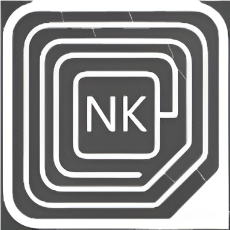

### ** NIKOS KARAMAROUDIS | SOFTWARE ENGINEER**
*High-Frequency Reactive Interfaces & Cyber-Brutalist Architecture*

 

 

[🌐 **EXPLORE LIVE PORTFOLIO**](https://nickkaramaroudisdev.com) • [💻 **VIEW GITHUB REPOS**](https://github.com/karamas13) • [🔗 **CONNECT ON LINKEDIN**](https://www.linkedin.com/in/nikos-karamaroudis-06676a233/)

---

## ⚡ // SYSTEM SPECIFICATIONS & ARCHITECTURE

A production-grade, immersive personal portfolio built to break standard UI conventions. Engineered for lightning-fast delivery times, fluid scroll physics, and absolute visual hierarchy.

* **🚀 Zero-Lag LCP Engine:** Bypasses thread-blocking framework entrance delays by rendering critical-path header elements instantly on frame 1.
* **🌀 Fluid Scroll Physics:** Powered by `React Lenis` inertia wrappers combined with hardware-accelerated GSAP `ScrollTrigger` viewports (`will-change-transform`).
* **📱 Adaptive Viewport Management:** Seamlessly transitions from desktop horizontal pinning sequences to centered, touch-optimized vertical flows on mobile devices.
* **🖱️ Hardware-Aware UX:** Custom cursor telemetry that dynamically scales on interactive targets and gracefully terminates on touch-only mobile/tablet hardware.

---

## 🛠️ // CORE STACK MATRIX

| Layer | Technology | Purpose |
| :--- | :--- | :--- |
| **Framework** | Next.js 15 (App Router) | Server-side rendering, SEO metadata, and dynamic routing |
| **Language** | TypeScript | Strict type safety across components and animation hooks |
| **Styling** | Tailwind CSS v4 | Cyber-brutalist utility classes, dark theme tokens, & custom grids |
| **Motion** | GSAP & Framer Motion | High-performance scroll pinning, parallax scaling, and modal transitions |
| **Optimization** | WebP / AVIF & `picture` | Responsive device-targeted image asset delivery |

---

## 📂 // FEATURED DEPLOYMENTS

* **Chrysus Digital** — Minimalist, high-performance web engineering and autonomous AI receptionist solutions for Greek enterprises.
  * *Stack:* Next.js, TypeScript, Tailwind CSS, Framer Motion
  * *Live:* [chrysusdigital.com](https://chrysusdigital.com/)
* **Kato Ap' To Avlaki** — Accessible, full-stack commerce web application backed by a real-time Supabase administrative backend.
  * *Stack:* Next.js, Supabase, PostgreSQL, Tailwind CSS
  * *Live:* [katwapotoaylaki.gr](https://katwapotoaylaki.gr/)
* **NB Photography** — Curated multi-device photo gallery with secure Firebase admin authentication and category-based storage management.
  * *Stack:* React, Node.js, Firebase, Tailwind CSS
  * *Live:* [nikosbriniasphotography.com](https://nikosbriniasphotography.com/)

---

